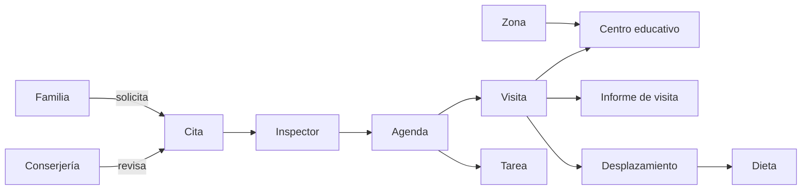

<div align="center">

# 🏫 Sistema de Gestión de la Inspección Educativa

**Servicio Provincial de Inspección Educativa de Cádiz**

Proyecto de la asignatura **Bases de Datos** · 2º Ingeniería Informática – Inteligencia Artificial
ETSII · Universidad de Sevilla · Curso 2026/2027

[](https://github.com/lorenzomaranon/ProyectoBD_Inspeccion_Educativa/actions/workflows/plantuml.yml)
[](https://github.com/lorenzomaranon/ProyectoBD_Inspeccion_Educativa/issues)
[](https://github.com/lorenzomaranon/ProyectoBD_Inspeccion_Educativa/issues?q=is%3Aissue+is%3Aclosed)
[](https://github.com/lorenzomaranon/ProyectoBD_Inspeccion_Educativa/pulls)
[](https://github.com/lorenzomaranon/ProyectoBD_Inspeccion_Educativa/commits/main)
[](#-equipo)


</div>

---

## 📑 Índice

- [El problema](#-el-problema)
- [Qué hace el sistema](#-qué-hace-el-sistema)
- [Entregas](#-entregas)
- [Estructura del repositorio](#-estructura-del-repositorio)
- [Modelo conceptual](#-modelo-conceptual)
- [Cómo trabajar con los diagramas](#-cómo-trabajar-con-los-diagramas)
- [Forma de trabajo del equipo](#-forma-de-trabajo-del-equipo)
- [Equipo](#-equipo)

---

## 🎯 El problema

La Inspección Educativa supervisa, evalúa y asesora a los centros educativos de la provincia
(funciones y atribuciones recogidas en los artículos 6 y 7 de su normativa, publicada en el BOE). Hoy buena parte de
su trabajo diario se gestiona a mano:

| Hoy | Con el sistema |
| --- | --- |
| 🧾 Dietas y kilometraje calculados a mano | Cálculo automático a partir de la visita y la tarifa vigente |
| 📝 Informe de visita en papel | Informe cumplimentado en tablet por el inspector responsable |
| 📅 Planificación de visitas sin automatizar | Agenda del inspector con visitas, tareas y anotaciones |
| 📞 Sin canal ordenado para las familias | Portal de citas con filtro previo de conserjería |

## 🧩 Qué hace el sistema



**Perfiles de usuario:** Inspector · Inspector Jefe · Conserjería · Responsable del centro educativo · Familias.

## 📦 Entregas

| # | Entrega | Contenido | Estado |
| :-: | --- | --- | --- |
| 0 | Propuesta de grupo | Organización, componentes y descripción del dominio | ✅ Entregada |
| 1 | Catálogo de requisitos | Descripción del problema, glosario, usuarios, requisitos generales (RG), de información (RI), funcionales/de conducta (RC), reglas de negocio (RN) y matriz de trazabilidad | ✅ Entregada |
| 2 | Catálogo mejorado + **modelo conceptual** | Diagramas de clases UML con reglas de negocio, escenarios de prueba y diagramas de objetos | 🚧 En curso · **1 de noviembre de 2026** |
| 3 | Modelo relacional | Paso del modelo conceptual a tablas, claves y restricciones | ⏳ Pendiente |
| 4 | Implementación SQL | Creación de la base de datos, consultas e integridad | ⏳ Pendiente |

> Las entregas 3 y 4 son la continuación prevista de la asignatura; su contenido exacto se
> concretará con cada enunciado.

## 🗂️ Estructura del repositorio

```text
ProyectoBD_Inspeccion_Educativa/
├── .github/workflows/
│   └── plantuml.yml          # Valida y renderiza los .puml en cada push / PR
├── docs/
│   ├── BD-MarañónMartínMartínPortillo .pdf                         # Propuesta del grupo (entrega 0)
│   ├── Gestión_de_Inspección_Educativa.pdf                        # Presentación del caso
│   ├── CATALOGO_REQUISITOS.pages                                  # Catálogo de requisitos (fuente, Pages)
│   ├── Especificaciones_Diseno_Software_..._Modelo_ER_Global.docx # Especificación de referencia del dominio
│   └── modelado_conceptual.puml                                   # Diagrama de clases UML (PlantUML)
└── README.md
```

| Documento | Para qué sirve |
| --- | --- |
| [Propuesta del grupo](docs/) | Presentación del equipo y de la organización: funciones y atribuciones de la inspección. |
| [Presentación del caso](docs/Gestión_de_Inspección_Educativa.pdf) | Descripción del caso de la inspección educativa en Cádiz. |
| [Catálogo de requisitos](docs/CATALOGO_REQUISITOS.pages) | Fuente del catálogo (se abre con Pages; para leerlo desde otro sistema conviene exportarlo a PDF). |
| [Especificaciones de diseño](docs/Especificaciones_Diseno_Software_Inspeccion_Educativa_Modelo_ER_Global.docx) | Visión amplia del dominio en 13 módulos (centros, actuaciones, planificación, visitas, informes, expedientes, organización, cuadro de mando, seguridad e indemnizaciones). Sirve de referencia; el alcance del proyecto es el del catálogo. |
| [Modelo conceptual](docs/modelado_conceptual.puml) | Diagrama de clases con las reglas de negocio enlazadas a las clases que afectan. |

## 🧠 Modelo conceptual

El diagrama está en [`docs/modelado_conceptual.puml`](docs/modelado_conceptual.puml). Cada
push que lo modifica lo valida y lo renderiza automáticamente (ver
[Actions](https://github.com/lorenzomaranon/ProyectoBD_Inspeccion_Educativa/actions/workflows/plantuml.yml)).

**Clases actuales:** `Inspector`, `InspectorJefe`, `CoordinadorZona`, `CentroEducativo`,
`Agenda`, `Visita`, `Tarea`, `Anotaciones`, `Informe`, `Desplazamiento`, `Dieta`, `Cita`,
`Familia`, `Conserjería`, `DiasAsuntosPersonales`, con los enumerados `e_EstadoCita` y
`e_Procedencia`.

### Reglas de negocio

| Regla | Descripción | Clases afectadas |
| --- | --- | --- |
| **RN-01** Dietas de desplazamiento | Kilometraje calculado desde el centro de Cádiz hasta el centro visitado, con la tarifa por km vigente (0,24 €/km hoy). | Desplazamiento, Dieta, Inspector |
| **RN-02** Plus de almuerzo | Si la llegada al domicilio es posterior a las 15:00 se añaden 20 € a la dieta. | Dieta |
| **RN-03** Permisos del informe | Solo el inspector responsable de la visita cumplimenta su informe. | Informe, Inspector |
| **RN-04** Proceso de cita | Las familias no contactan directamente con el inspector: la solicitud va por el portal y pasa por conserjería. | Cita, Familia, Conserjería |
| **RN-05** Subordinación de tareas | Solo el inspector jefe y los coordinadores de zona crean o modifican tareas en la agenda de un inspector. | Tarea, InspectorJefe, CoordinadorZona, Agenda |
| **RN-06** Días de asuntos personales | Cada inspector consulta solo los suyos; el inspector jefe consulta los de todos. | Inspector, InspectorJefe, DiasAsuntosPersonales |

## 🛠️ Cómo trabajar con los diagramas

**En VS Code** (lo más cómodo): extensión
[PlantUML](https://marketplace.visualstudio.com/items?itemName=jebbs.plantuml) y
`Alt + D` para la vista previa. Necesita Java y Graphviz:

```bash
# macOS
brew install openjdk graphviz plantuml

# Ubuntu / Debian
sudo apt install default-jre graphviz plantuml
```

**Desde la terminal:**

```bash
plantuml -checkonly docs/*.puml   # solo comprueba la sintaxis
plantuml -tpng docs/*.puml        # genera el PNG junto al .puml
plantuml -tsvg docs/*.puml        # o SVG, que escala sin perder calidad
```

**En GitHub:** cada push o PR que toque un `.puml` lanza el workflow
[Diagramas PlantUML](.github/workflows/plantuml.yml). Si el diagrama tiene un error de sintaxis
el badge se pone en rojo; si compila, los PNG y SVG quedan en el artefacto `diagramas` de esa
ejecución, listos para pegar en el PDF de la entrega.

## 🤝 Forma de trabajo del equipo

- **Rama principal:** `main`. Para cambios grandes (un diagrama nuevo, una sección del
  catálogo), mejor una rama y un pull request para que otro del grupo lo revise.
- **Issues:** una issue por tarea de la entrega (p. ej. *Escenario de prueba: solicitud de
  cita*), asignada a quien la lleve. Etiquetas: `documentation` para el catálogo y los textos,
  `enhancement` para el modelo, `question` para dudas a consultar con la profesora.
- **Commits:** en español y en presente, diciendo qué cambia: *Añade clase Zona*,
  *Corrige multiplicidad Visita–Informe*.
- **Documentos:** junto al `.pages` o `.docx` de cada entrega, sube también su exportación en
  PDF para que todo el grupo pueda leerla.

## 👥 Equipo

| | Integrante | GitHub |
| :-: | --- | --- |
| 🧑‍💻 | Lorenzo Marañón Piñero | [@lorenzomaranon](https://github.com/lorenzomaranon) |
| 🧑‍💻 | Roberto Martín Carmona | [@Robertomartin-7](https://github.com/Robertomartin-7) |
| 🧑‍💻 | Jaime Martín Palomino | [@Jaiime07](https://github.com/Jaiime07) |
| 🧑‍💻 | Javier Portillo Velasco | [@javiporti](https://github.com/javiporti) |

---

<div align="center">
<sub>Proyecto académico · Bases de Datos · Universidad de Sevilla · 2026/2027</sub>
</div>
